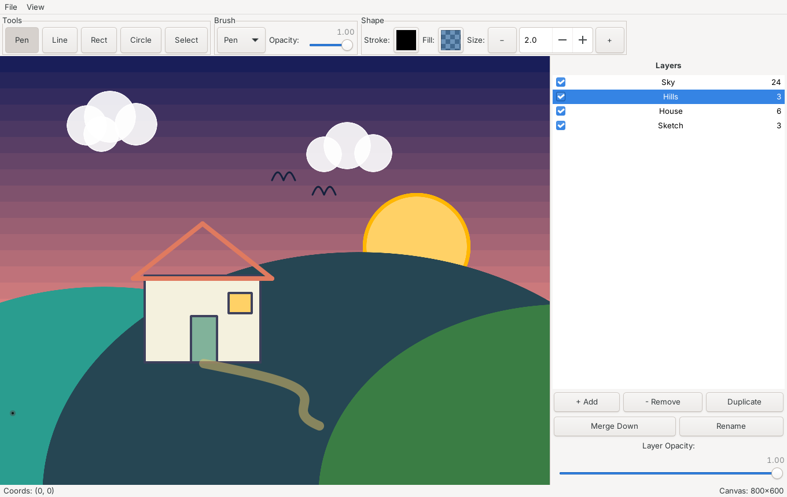

# LunarDraw

A lightweight 2D drawing application for Linux, written in C++17 with GTK3 and Cairo.

LunarDraw lets you sketch freehand, draw shapes, place images, and organize your work across layers — with everything saved in a custom `.lunar` project format.



## Features

- **Drawing tools** — freehand pen, marker, spray, and eraser brushes
- **Shapes** — lines, rectangles, and circles (including circle-from-center); hold `Shift` to constrain
- **Images** — import PNG/JPG files directly onto the canvas
- **Layers** — add, rename, reorder, merge down, and adjust per-layer opacity
- **Style controls** — stroke/fill color (with hex support), brush size, and opacity
- **Selection** — move, duplicate, and delete shapes; optional on-canvas measurements
- **Project files** — save/load projects as `.lunar`
- **Export** — render the canvas to PNG

## Building

Requirements:

- C++17 compiler (GCC or Clang)
- CMake ≥ 3.16
- GTK3 development packages (`libgtk-3-dev`)
- `pkg-config`

```bash
sudo apt install build-essential cmake pkg-config libgtk-3-dev   # Debian/Ubuntu
cmake -B build
cmake --build build
```

The binary is placed at `build/lunardraw`.

### Install

```bash
sudo cmake --install build
```

This installs the `lunardraw` binary, a `.desktop` entry, and MIME type registration.

## Usage

Launch the app:

```bash
./build/lunardraw
```

- **File → New / Open Project (.lunar) / Save Project** — manage projects
- **File → Open Image (PNG/JPG)** — import an image onto the canvas
- **File → Export PNG** — export the current canvas
- Pick a tool from the toolbar, then draw on the canvas. Use `Shift` while drawing lines/shapes for constrained angles.
- Manage layers from the Layers panel: rename, set opacity, or merge down.

## Project Structure

```
src/
├── main.cpp         # Entry point
├── mainwindow.cpp/h # GTK window, menus, and toolbar
├── canvas.cpp/h     # Drawing surface, input handling, rendering
├── shape.cpp/h      # Shape primitives and serialization
├── layer.cpp/h      # Layer model
├── project.cpp/h    # Project state and .lunar save/load
└── types.h          # Shared types (Color, ShapeType, BrushType)
tests/
└── test_saveload.cpp
```

## License

All rights reserved. Contact the author for licensing details.

---

## More projects by vSake

- **[Fih](https://github.com/vSake-clean/Fih)** — programming language with a compiler written in pure x86-64 assembly, no libc
- **[Szept](https://github.com/vSake-clean/Szept)** — serverless Android messenger
- **[LuminaView](https://github.com/vSake-clean/LuminaView)** — fast, lightweight Qt5 image viewer for Linux
- **[StatusCycler](https://github.com/vSake-clean/StatusCycler)** — Vencord plugin that cycles your Discord custom status
- **[vencord-AutoReply](https://github.com/vSake-clean/vencord-AutoReply)** — Vencord plugin for automatic replies with triggers and filters
- **[vencord-StickyNotes](https://github.com/vSake-clean/vencord-StickyNotes)** — Vencord plugin for sticky notes on Discord users
- **[vencord-friendgroups](https://github.com/vSake-clean/vencord-friendgroups)** — Vencord plugin to group friends in the DM sidebar

If you like this project, consider leaving a ⭐ — it really helps!
